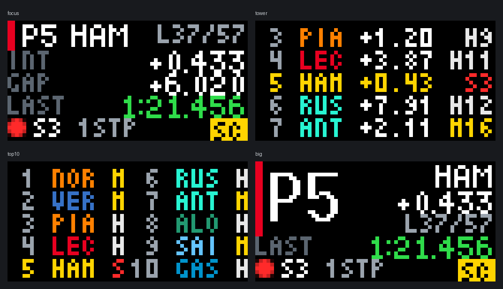
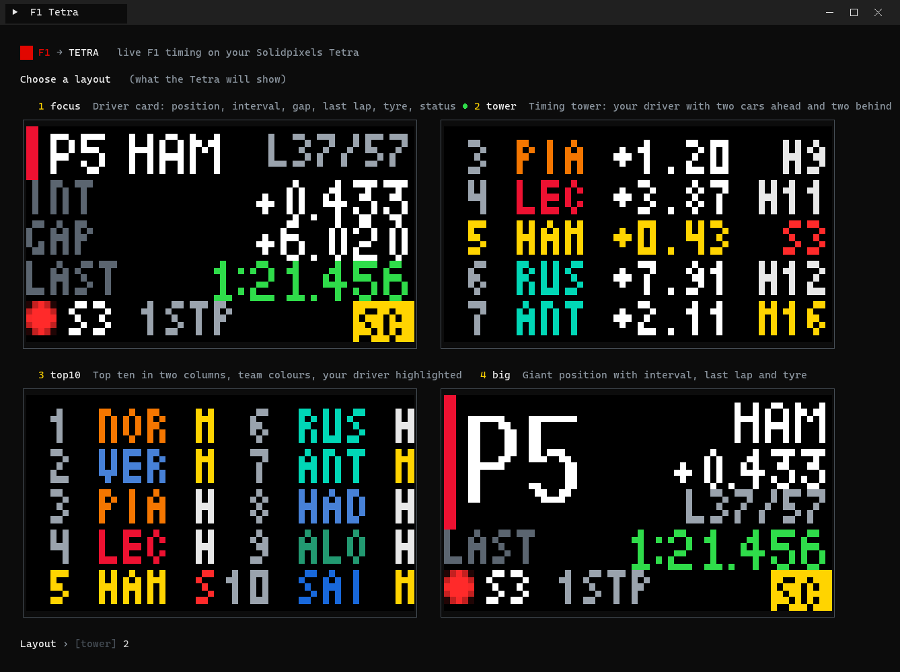
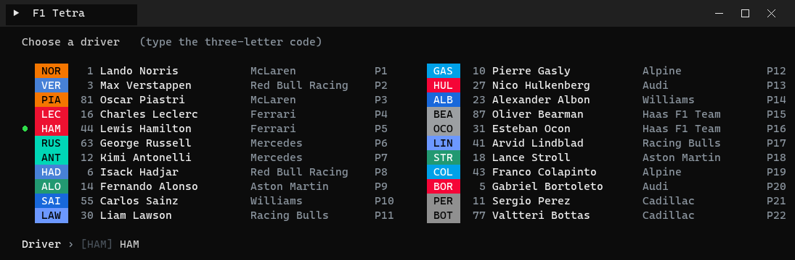
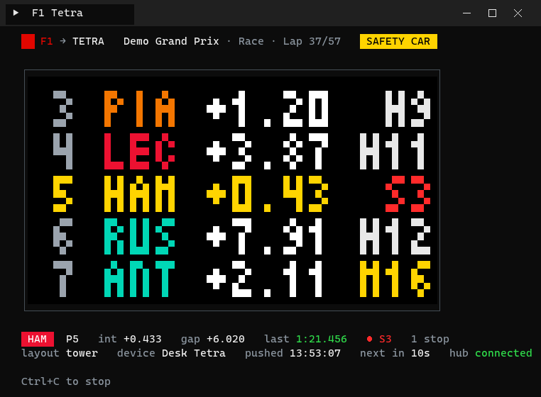

# F1 Live Timing for the Solidpixels Tetra

Follow one Formula 1 driver live on a [Solidpixels Tetra](https://solidpixels.io)
64x32 LED display: position, interval, gap, last lap, tyre and track status,
updated every ten seconds during a session. Four layouts, a colour console UI
to pick them from, and a live mirror of the display in your terminal.



| Layout | What it shows |
| --- | --- |
| `focus` | Driver card: position, interval, gap to leader, last lap (green = personal best, purple = overall fastest), tyre and age, stops, status badge (SC / VSC / YEL / RED / PIT / OUT / FIN) |
| `tower` | Timing tower window: your driver (yellow) with two cars ahead and two behind, interval, tyre and age, team-coloured names |
| `top10` | The top ten in two columns, team colours, tyre letter, your driver highlighted (and swapped into the last slot if outside the ten) |
| `big` | Giant position with driver, interval, lap counter, last lap and tyre |

## How it works

Solidpixels apps run in the Solidpixels cloud and can only make plain HTTP
requests, so they cannot hold a connection to the F1 timing hub. Instead a
small bridge runs on your PC during a session:

1. `bridge.py` connects to `livetiming.formula1.com/signalrcore`, the public
   SignalR feed the official F1 app and the [FastF1](https://github.com/theOehrly/Fast-F1)
   library use (WebSocket, with long-polling as a fallback). No account or key
   is needed, but it only accepts connections from residential IP addresses.
2. It keeps the merged live state, pulls out the running order and your
   driver, and renders `app.star` with the [Tetra CLI](https://docs.solidpixels.io/app-development/local/).
3. It pushes the 64x32 WebP to your device through the
   [Solidpixels Public API](https://docs.solidpixels.io/public-api/) every ten
   seconds as a persistent rotation entry called `f1-live`, so the card stays
   on screen between pushes. When you stop the bridge it leaves a small
   "F1 LIVE / bridge off" card in the rotation; `--clear` removes it.

Between sessions the hub serves the last session's final board, so you can
set everything up and test it on a Tuesday.

## The console



Every layout is rendered from the hub's current data and drawn in the
terminal in 24-bit colour, two pixels per character, so you see exactly what
the Tetra will show before you choose.



The driver list comes from the timing hub, in team colours, with race numbers,
names, teams and current positions. Type the three-letter code. Both choices
are remembered, so next time Enter keeps them.



While it runs the console redraws in place: meeting, session and lap, a flag
badge in the track-status colour, a mirror of the frame on the device, your
driver's numbers, the last push time and a countdown to the next one.

## Requirements

- A Solidpixels Tetra on the same account as your API key.
- Windows, macOS or Linux with Python 3.9 or newer and the `websocket-client`
  and `Pillow` packages:

  ```bash
  pip install websocket-client Pillow
  ```

- The Tetra CLI from Solidpixels. On Windows the install script in the
  [local development docs](https://docs.solidpixels.io/app-development/local/)
  puts `tetra.exe` in `%LOCALAPPDATA%\Programs\Tetra` and on your PATH; on macOS
  it is `brew install solidpixels-inc/solidpixels/tetra`.
- A Solidpixels API key: sign in at https://app.solidpixels.io, open
  *Development Resources -> API keys* and create one. It is shown once.
- Windows Terminal (the default on Windows 11) or any terminal with 24-bit
  colour for the console UI. The older console host works too.

## Setup

```bash
git clone https://github.com/growe19/tetra-f1-live.git
cd tetra-f1-live
copy config.example.json config.json
```

Edit `config.json`: paste your API key into `api_key` (or set the
`SOLIDPIXELS_API_KEY` environment variable and leave it empty). `device_id`
can stay empty if you have one device. `config.json` is git-ignored.

Check the connection:

```bash
.\f1 --devices
```

On macOS or Linux use `python3 bridge.py` in place of `.\f1`.

## Run

```bash
.\f1
```

Pick a layout, pick a driver, and the bridge goes live. It pushes a first
frame straight away, updates every ten seconds while the session status is
live, and waits quietly when nothing is on. Ctrl+C stops it.

Skip the menus:

```bash
.\f1 --driver NOR --layout tower --no-prompt
```

Preview without touching the device:

```bash
.\f1 --demo --render-only
```

| Switch | Effect |
| --- | --- |
| `--driver VER` | driver code for this run |
| `--layout tower` | `focus`, `tower`, `top10` or `big` |
| `--no-prompt` | skip the menus, use config / flags |
| `--answers "2,NOR"` | answer the menus from the command line |
| `--demo` | fake race data, no hub connection |
| `--render-only` | write `frame.webp` but do not push |
| `--once` | one frame then exit |
| `--always` | keep pushing even when the session is not live |
| `--temporary` | expiring overlay pushes instead of a rotation entry |
| `--plain` | one log line per push instead of the colour dashboard |
| `--devices` | list the devices on your account |
| `--clear` | remove the `f1-live` entry from the device and exit |

## config.json

| Key | Default | Meaning |
| --- | --- | --- |
| `driver` | `VER` | three-letter driver code |
| `layout` | `focus` | `focus`, `tower`, `top10` or `big` |
| `api_key` | | Solidpixels API key (or env `SOLIDPIXELS_API_KEY`) |
| `device_id` | | device ID, serial or MAC; empty = first device on the account |
| `push_every` | `10` | seconds between pushes |
| `mode` | `installation` | `installation` (rotation entry) or `temporary` (expiring overlay) |
| `installation_id` | `f1-live` | name of the rotation entry |
| `duration` | `15` | overlay seconds in temporary mode (5, 10, 15, 30, 35, 40, 45) |
| `tetra` | `tetra` | path to the Tetra CLI if it is not on PATH |

## Cloud version

`app.star` also accepts a `src` config value: a URL returning the same fields
as JSON. If you host that JSON somewhere, the same app can be created in the
Solidpixels cloud editor, previewed, tested on the device and submitted for
review as a proper installable app. Without `src` it renders "F1 LIVE waiting".

## Files

- `app.star` - the Tetra app (Starlark), all four layouts
- `bridge.py` - F1 hub -> render -> push loop
- `ui.py` - console UI: frame previews, team-coloured driver menu, live dashboard
- `f1.cmd` - Windows launcher
- `config.example.json` - template for `config.json`
- `tools/make_screenshots.py` - regenerates the console images below from the real UI
- `docs/` - the images above

## Notes

- Not affiliated with Formula 1, the FIA or Solidpixels. F1 timing data is
  used as the official app exposes it, for personal use only.
- The SignalR client and the JSON patch-merge logic are a Python port of the
  live-timing code in the author's ESP32 F1 desk display.
- MIT licence.
